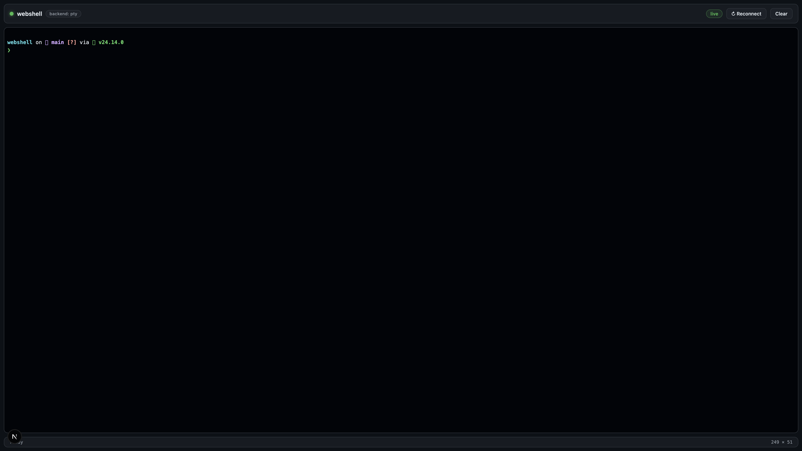

# webshell

A stable, good-looking web-based terminal built with **Next.js**, **node-pty**, and **xterm.js**. Run your shell from the browser with full interactivity — colors, vim, htop, ctrl-c, tab completion, everything.



## Features

- **Real PTY terminal** — `node-pty` streams a genuine shell session (`$SHELL`), not a command executor
- **Full interactivity** — vim, htop, less, interactive prompts, ctrl-c/ctrl-d, 256-color + truecolor
- **Polished UI** — dark GitHub-style theme, live connection status, terminal size readout
- **Live resize** — terminal refits on window resize and propagates `TIOCSWINSZ` to the shell
- **Auto reconnection** — session-ended overlay with one-click restart
- **Opt-in auth** — set `WEBSHELL_USER` + `WEBSHELL_PASS` for HTTP basic auth (also guards the WebSocket)
- **Graceful fallback** — if the native `node-pty` module can't build, a piped-shell fallback keeps commands working

## Quick start

```bash
npm install
npm run dev
# open http://localhost:3000
```

Production:

```bash
npm run build
npm start
```

## Configuration (environment variables)

| Variable | Default | Description |
|---|---|---|
| `PORT` | `3000` | HTTP port |
| `HOST` | `127.0.0.1` | Bind address (keep `127.0.0.1` unless you add auth) |
| `SHELL` | `$SHELL` or `/bin/zsh` | Shell to spawn |
| `WEBSHELL_CWD` | project dir | Working directory for the shell |
| `WEBSHELL_USER` / `WEBSHELL_PASS` | unset | Enable HTTP basic auth when both are set |

## Architecture

```
server.js              custom Next.js server
├─ Next.js             renders the React UI (app router)
└─ WebSocket /api/term streams a node-pty session (fallback: piped shell)

app/
├─ layout.js           loads xterm.css + globals.css
├─ page.js             "use client" — xterm.js terminal, WebSocket client
└─ globals.css         dark theme, titlebar, statusbar, overlay
```

Protocol (JSON over WebSocket, both directions):

- client → server: `{type: "hello"}`, `{type: "start", cols, rows}`, `{type: "input", data}`, `{type: "resize", cols, rows}`
- server → client: `{type: "backend", backend}`, `{type: "data", data}`, `{type: "exit", code}`

## Security notes

- Binds to `127.0.0.1` by default — do not expose a shell to your network without `WEBSHELL_USER`/`WEBSHELL_PASS` (or a reverse proxy with TLS + auth).
- A webshell grants full shell access to whoever can reach it. Treat the host as trusted.

## Tech stack

- [Next.js 15](https://nextjs.org) — UI + custom server
- [node-pty](https://github.com/microsoft/node-pty) — pseudo-terminal (`node-pty@beta` on Node ≥ 24 / macOS)
- [xterm.js](https://xtermjs.org) — terminal emulator in the browser
- [ws](https://github.com/websockets/ws) — WebSocket transport